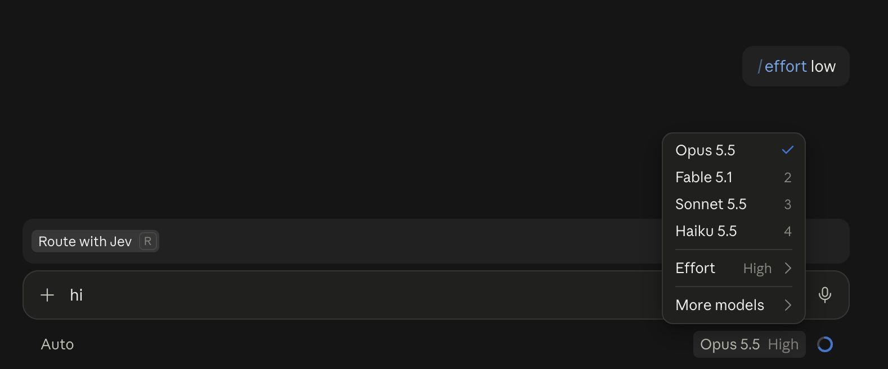
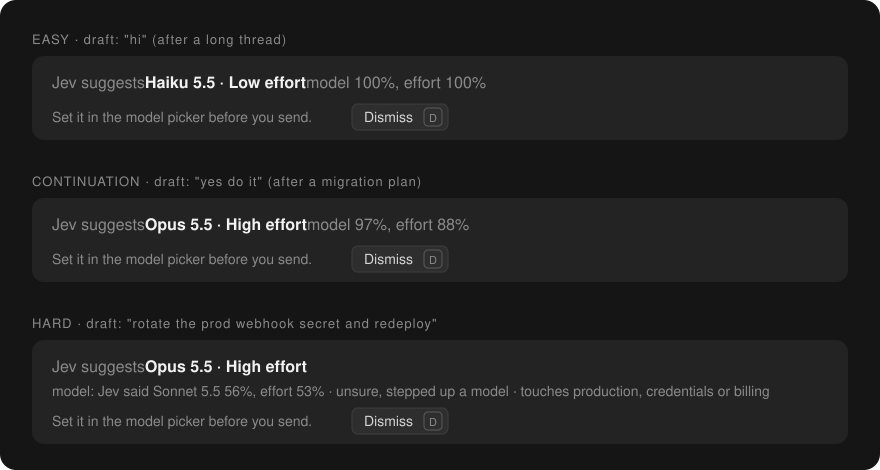
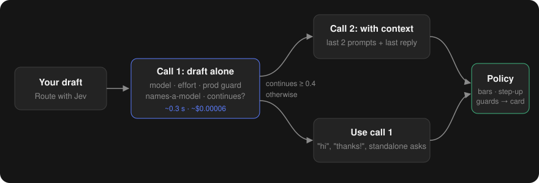

# jev-router

**A Claude Code mod that tells you which Claude model and effort level fit the message you're about to send.**

Type your message, press **Route with Jev**, and a card suggests the model and effort for it. "hi" gets Haiku at low effort. "find why this test fails intermittently and fix it" gets Opus at high. The scoring is done by [Jev](https://docs.typesafe.ai), TypeSafe's non-generative decision model. It answers in about 0.3 s for roughly $0.00006 a call. You set the model in the picker yourself; the mod never changes your settings or sends anything.





## Install

You need Claude Code and a key for Jev (see [Keys](#keys)).

```bash
claude plugin marketplace add pbswimmer3/claude-jev-router
```

```bash
claude plugin install jev-router@claude-jev-router --scope user
```

Then start a new session, or run `/reload-plugins` in an open one. The button appears above the prompt box in every Claude Code session on that machine: the desktop app's Code tab, the terminal, and the IDE extensions.

> It doesn't run in claude.ai's regular Chat tab. Mods are a Claude Code feature.

## Use it

1. Type your message. Don't send it yet.
2. Click **Route with Jev**, or focus the bar and press `R`.
3. Read the card, then set that model and effort in the model picker and send. **Dismiss** (`D`) clears the card.

### In a new session

The desktop app's **New session** screen is the app's own launcher: no session has started yet, so no mod runs there and the button can't show. Instead the mod asks Jev about a new session's first message as you send it, and the card shows while that first turn runs. It names the model the message is running on, so you can switch in the picker for the next message, or stop and resend. Later messages go back to the button. A message you already routed with the button isn't asked about twice. The app's own notes in a message (`<system-reminder>` blocks) are left out of what Jev scores, and a session another session started isn't routed, since you didn't type its first message.

The card tells you when something other than Jev's own top pick decided the result:

| Card says | Meaning |
|---|---|
| `model: Jev said Haiku 5.5 92% · unsure, stepped up a model` | Jev's top pick wasn't confident enough, so the mod moved up to the stronger of Jev's top two. |
| `model: Jev said Fable 5.1 56% · Fable only when Jev is sure` | Jev picked Fable but wasn't at least 70% sure, so the card suggests Opus. |
| `touches production, credentials or billing` | The draft changes something risky, so the pick is at least Opus at high effort. |
| `you asked for opus; Jev would pick sonnet` | Your message said "use opus" (an instruction, not just a mention), so that wins. |

## How it decides



1. **One call on the draft alone.** Jev answers five questions in a single request: which model, which effort, whether the draft touches production/credentials/billing, whether it names its own model, and whether it continues earlier work.
2. **Context only for continuations.** "yes do it", "try again" and "why did that fail?" only make sense against the earlier conversation, so they get a second call with your last two prompts and Claude's last reply attached. Greetings, thanks and standalone requests don't. Without this rule, a "hi" at the end of a long technical thread would inherit that thread's difficulty.
3. **A policy turns probabilities into a pick.** Cheaper picks need more certainty: Haiku must clear 95% and Sonnet 85%. Below its bar, the mod takes the stronger of Jev's top two, but it never steps up into Fable or max effort; those only come from a direct pick, and Fable also needs Jev to be at least 70% sure (otherwise Opus). Then the production guard and your own instruction apply.

Obvious secrets (API keys, tokens, `password=` values) are scrubbed before anything leaves your machine. Tool output and file contents are never sent.

## Keys

The mod looks for a key in this order:

1. `JEV_API_KEY` or `MERGE_GATEWAY_KEY` in the environment.
2. The same variable names in `~/.config/jev-router/.env` (or the file named in the `keyFile` setting).

| Provider | `jevEndpoint` | `jevModel` |
|---|---|---|
| [Merge Gateway](https://www.merge.dev/gateway/jev-1-13) (default) | `https://api-gateway.merge.dev/v1/decisions` | `typesafe/jev-1.13` |
| [TypeSafe](https://console.typesafe.ai) direct | `https://api.typesafe.ai/v1/systemone` | `jev-1.13.0` |
| Local [Kev](https://github.com/jaredpalmer/kev) (no key) | `http://127.0.0.1:8009/v1/systemone` | `kev-latest` |

Change the endpoint and model with `/plugin configure jev-router@claude-jev-router` in a terminal session. Through Merge Gateway, option descriptions must be plain strings; the rubric already is.

## How well it works

It was tuned on sets A–C and then checked on a fresh held-out set D. Numbers for A–C hold in both option orders, since Jev 1.13 leans slightly toward whichever option comes first:

| Set | What it is | Model exact | Effort exact |
|---|---|---|---|
| A | 58 public prompts from [dirien/jev-router](https://github.com/dirien/jev-router) | 90–95% | – |
| B | 120 real Claude Code prompts, labeled from their outcomes | 64–68% | 49–57% |
| C | 160 graded prompts (easy/medium/hard, 40 with context), blind-labeled by two models | 88–89% | 83–89% |
| D | 100 held-out prompts across coding, data, writing, research and strategy, never used for choosing settings | 87% | 87% |

- **Greetings after a long thread:** 12 of 12 now land on Haiku. Before the context rule, 3 of 12 did.
- **Continuations:** 12 of 14 inherit the work they continue.
- **Under-routing:** the cases where it picks a model too weak for the job stay at or below 9% on every set, and 0% on the held-out set D, where every model pick was within one tier of the labels.
- **Speed and cost:** 0.2–0.4 s for one call, 0.6–0.8 s when the second call fires, about $0.00006 per call through Merge Gateway.

A local Kev-0.8B was also tested. It picks largely by option position, so reversing the option order flipped 53% of its picks, against 8% for Jev. It isn't recommended for routing.

**Known weak spots:**
- Design and strategy asks (a rate-limiter design, a pricing change, a threat model) sometimes still get Fable where Opus would do, when Jev is very sure. A 70% Fable bar removes most of these (held-out set D went from 84% to 87%); rewording Fable's definition was tried and rejected, because real Fable-level prompts dropped to Opus.
- "Check this vendor's API docs" asks tend to get Haiku where Sonnet is safer.
- Haiku is rare, by design: the 95% bar is deliberately strict.

## Why suggest-only

Early versions had an **Apply** button that ran `/model` and `/effort` for you. That changes the session underneath, but the desktop app's model pill keeps its own setting and doesn't update, so what you saw and what ran could disagree. Until mods can set the pill, you make the change yourself.

## Develop

```bash
claude plugin validate .
```

```bash
claude plugin test .
```

- `hooks/rubric.ts`: the questions Jev is asked.
- `hooks/route.ts`: the bars, step-up rule and guards.
- `hooks/jev.ts`: request building, scrubbing and parsing.
- `hooks/register.tsx`: the button, the card, and first-message routing.

If you change the Jev version, retune the bars; they were set on `jev-1.13.0`.

## Credits and license

The routing questions and the confidence-bar/step-up policy are adapted from [jev-router](https://github.com/dirien/jev-router) by Engin Diri. Licensed under [Apache-2.0](LICENSE); see [NOTICE](NOTICE). Jev outputs are subject to TypeSafe's terms, which forbid using them to train a model that imitates Jev.
